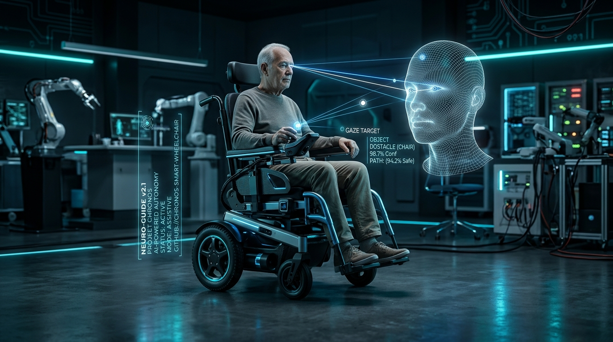
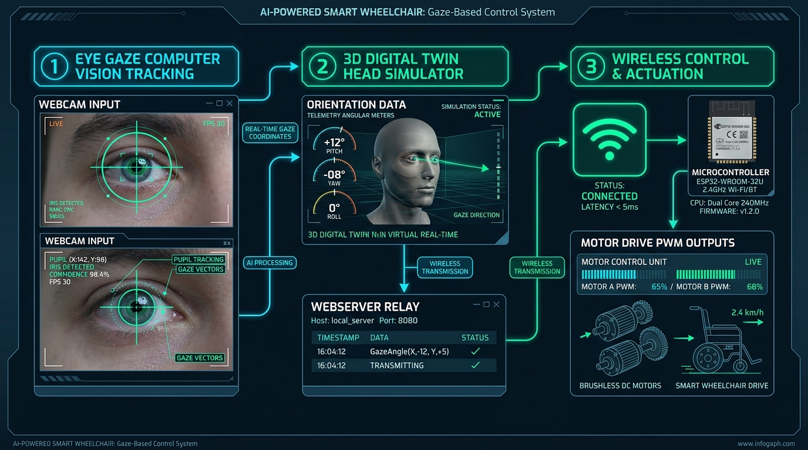
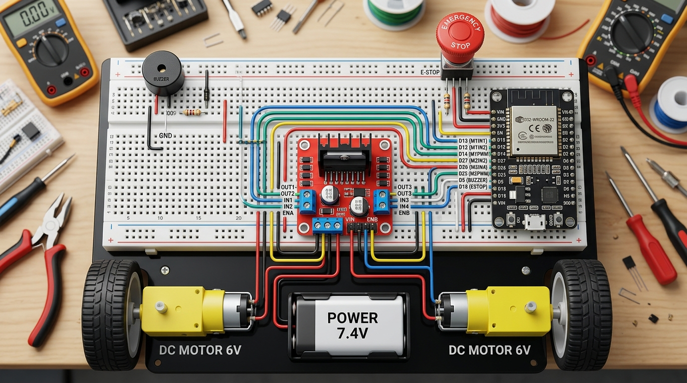

<div align="center">

# ♿ الكرسي المتحرك الذكي بالتحكم عبر بؤبؤ العين والرأس
## AI-Powered Smart Wheelchair: Eye-Gaze & Head Motion Control with ESP32 & 3D Digital Twin

[](https://www.espressif.com/)
[](https://opencv.org/)
[](https://react.dev/)
[](https://threejs.org/)
[](https://github.com/)
[](https://opensource.org/licenses/MIT)

<br/>

<p align="center">
  
</p>

**مشروع هندسي وتطبيقي متكامل يهدف لتمكين ذوي الشلل الرباعي والاحتياجات الخاصة الحركية من قيادة وتحريك كرسي متحرك كهربائي ذاتياً بالاعتماد الكامل على حركة بؤبؤ العين (Eye Gaze) أو زوايا إيماء الرأس (Head Pose)، مع توأم رقمي تفاعلي ثلاثي الأبعاد (3D Digital Twin)، وربط لاسلكي فوري عبر شبكة Wi-Fi ومتحكم ESP32، ونظام فرملة أمان حيوي ذكي (Deadman Safety Brake).**

---

[📋 نبذة عن المشروع](#-نبذة-عن-المشروع) •
[✨ المميزات الرئيسية](#-المميزات-الرئيسية) •
[🏗️ معمارية النظام ومسار البيانات](#-معمارية-النظام-ومسار-البيانات) •
[🔌 المخطط الكهربائي وجدول التوصيل](#-المخطط-الكهربائي-وجدول-التوصيل) •
[📡 بروتوكول الأوامر والقيادة](#-بروتوكول-الأوامر-والقيادة) •
[🚀 خطوات التثبيت والتشغيل](#-خطوات-التثبيت-والتشغيل) •
[🛡️ أنظمة الأمان](#-أنظمة-الأمان-المعتمدة) •
[📁 هيكل الملفات](#-هيكل-ملفات-المشروع)

---

</div>

<br/>

## 📋 نبذة عن المشروع

يُعد هذا المشروع حلاً تقنياً مبتكراً ومفتوح المصدر موجهاً للأشخاص الذين يعانون من فقدان القدرة على استخدام الأطراف العلوية (كحالات التصلب الجانبي الضموري **ALS** وإصابات الحبل الشوكي والشلل الرباعي).

يقوم النظام بتحليل مسار نظرة العين عبر كاميرا رقمية خفيفة باستخدام خوارزميات رؤية الحاسوب والذكاء الاصطناعي (**OpenCV Computer Vision**)، واستخلاص اتجاه بؤبؤ العين اللحظي ونسبة انفراج الجفن بدقة فائقة. يتم نقل هذه المؤشرات إلى **سيرفر محاكاة ثلاثي الأبعاد لحظي** يوضح حركة الرأس وعضلات العين في الوقت الفعلي، وتُبث أوامر القيادة آلياً عبر شبكة **Wi-Fi** بتردد عالٍ إلى متحكم **ESP32** الموصول بدرايفر محركات **L298N** لتحريك عجلات الكرسي في الاتجاه المطلوب، مع فرملة إيقاف تلقائية وفورية في حال إغلاق العين أو انقطاع الاتصال.

<br/>

---

## ✨ المميزات الرئيسية

* 👁️ **تتبع بؤبؤ العين فائق الدقة (Precision Eye-Gaze Tracking)**:
  * خوارزمية تكيفية لمعالجة منطقة العين (Eye ROI) واستخراج النقطة الداكنة للبؤبؤ مع استبعاد الحواجب والرموش.
  * التعرف الدقيق على الاتجاهات الخمسة: **يمين (`R`)**، **يسار (`L`)**، **أمام (`F`)**، **خلف (`B`)**، و**توقف (`S`)**.
  * معايرة تلقائية أو يدوية لنقطة الصفر الحيادية (Neutral Gaze Calibration).
* 🛡️ **فرملة الأمان الحيوي الذاتي (Deadman Safety Brake)**:
  * حساب نسبة فتح العين والجفن لحظياً (`Eye Openness %`).
  * في حال إغماض العين أو النوم أو فقدان الوعي، يتوقف الكرسي فوراً خلال جزء من الثانية (`Command = STOP` و `PWM = 0`).
* 🧍 **فصل تام ومستقل بين حركة الرأس وبؤبؤ العين**:
  * فصل خوارزميات كينماتيكا الرأس (Pitch/Roll/Yaw) عن اتجاه حركة البؤبؤ لمنع أي تداخل غير مقصود.
  * 3 أوضاع تشغيل مرنة: **(1) بؤبؤ العين فقط** | **(2) إيماءات الرأس فقط** | **(3) تحكم هجين مدمج**.
* 🌐 **ربط لاسلكي Wi-Fi فائق السرعة وبدون تأخير (Ultra-Low Latency Wi-Fi)**:
  * يدعم نمط عميل الراوتر (**Station Mode**) ونمط نقطة الوصول المستقلة (**Access Point**) تلقائياً.
  * خادم ويب مدمج (**HTTP REST WebServer**) + قناة بث لحظي (**TCP Socket / WebSocket**).
  * خادم وسيط خلفي (**Local Node.js Relay**) يتجاوز قيود أمان المتصفح (CORS & Mixed Content) ويرسل الأوامر في 2-5ms.
* ⚡ **تحكم متقدم بالمحركات وعزم الدوران (High-Torque Differential Drive)**:
  * اعتماد أحدث مكتبات **ESP32 Core 3.x API** (`ledcAttach` و `ledcWrite`) بتردد 5000Hz.
  * رفع عزم الالتفاف إلى **255 Max Torque (100% PWM)** مع دفع تفاضلي متعاكس للتغلب التام على احتكاك الإطارات بالأرضية.
  * تصحيح قطبية المحركات برمجياً لحل مشكلة الاتجاه المعكوس بدون الحاجة لتعديل الأسلاك.
* 🖥️ **توأم رقمي ثلاثي الأبعاد (3D Digital Twin Simulation)**:
  * نموذج رأسي تشريحي احترافي مُضاء بمصفوفة أسلاك بيضاء علمية (Wireframe Mesh).
  * تمثيل لحظي لحركة كرة العين (Eyeball Rotation) وزوايا الرقبة وعنق الرحم (Cervical Spine Articulation).
  * لوحة قياس عن بُعد (Telemetry HUD) تضم مؤشرات الزوايا وسجلات الحزم المرسلة لحظياً.
* 🚨 **أنظمة طوارئ وحماية مادية متعددة الطبقات**:
  * زر طوارئ أحمر فيزيائي (`D32`) مع مانع ارتداد (Debounce) لقطع الحركة فوراً.
  * مؤقت أمان زمني (**Safety Timeout 3s**) لإيقاف الكرسي آلياً عند انقطاع بث الإشارة.
  * تنبيهات صوتية وبصرية متقطعة (Passive Buzzer `D4` و LED أحمر خافت `D2`).

<br/>

---

## 🏗️ معمارية النظام ومسار البيانات

<p align="center">
  
</p>

يتكون النظام من ثلاث طبقات رئيسية مترابطة بتدفق بيانات لحظي مستمر:

```text
┌─────────────────────────┐          HTTP / JSON          ┌───────────────────────────┐          Wi-Fi (REST / TCP)          ┌───────────────────────────┐
│     1. رؤية الحاسوب     │ ────────────────────────────► │     2. سيرفر المحاكاة     │ ───────────────────────────────────► │      3. الكرسي والمحرك    │
│  (Python 3 + OpenCV)    │      Port 3000 / API          │   (Node.js + Three.js)    │        IP: 192.168.4.1:80            │  (ESP32 + L298N Motors)   │
│                         │                               │                           │                                      │                           │
│ • كشف الوجه والعين      │                               │ • معالجة الأوامر اللحظية  │                                      │ • توليد إشارات PWM 5KHz   │
│ • تتبع بؤبؤ العين بدقة  │                               │ • عرض التوأم الرقمي 3D    │                                      │ • قيادة المحركين بتفاضل   │
│ • فرملة إغلاق الجفن     │                               │ • وسيط إعادة البث التلقائي│                                      │ • زر الطوارئ ومؤقت الأمان │
└─────────────────────────┘                               └───────────────────────────┘                                      └───────────────────────────┘
```

1. **الطبقة الأولى: المعالجة البصرية (Vision Tier - `eye_tracker.py`)**:
   تفتح كاميرا الويب وتلتقط الإطارات بدقة 640×480 وبمعدل 30-60 إطار/ثانية. تطبق نماذج Haar Cascade لاقتطاع منطقة العين، ثم تعزل البؤبؤ عبر خوارزمية العتبة التكيفية (Adaptive Thresholding) والمركز الكتلي (Centroid). تُرسل النتائج بهيئة JSON إلى السيرفر المحلي `http://localhost:3000/api/eye-tracking`.

2. **الطبقة الثانية: وسيط التحكم والمحاكاة (Simulation & Relay Tier - `server.ts` & React)**:
   يستقبل السيرفر بيانات الإزاحة وزوايا الرأس، ويبثها للمتصفح عبر تقنية Server-Sent Events (SSE) لتحريك العينين والرأس في فضاء Three.js التفاعلي. بالتزامن، يقوم وسيط السيرفر (`Server Relay Proxy`) بإرسال أمر القيادة فورياً عبر Wi-Fi إلى الـ ESP32.

3. **الطبقة الثالثة: المعالجة الميكاترونية والمحركات (Embedded & Actuation Tier - `Chair_WiFi_Full.ino`)**:
   يستقبل متحكم ESP32 الأمر (`F`, `B`, `L`, `R`, `S`, `E`)، ويقوم بضبط قطبية مخارج درايفر L298N وتوليد ترددات PWM بسرعة تصل إلى 255 لتحريك المحركات بأمان كامل.

<br/>

---

## 🔌 المخطط الكهربائي وجدول التوصيل

<p align="center">
  
</p>

### 📌 جدول أطراف متحكم ESP32 (30-Pin DevKit V1):

| طرف الـ ESP32 | متصل بمكون | الغرض والوظيفة | الوصف التقني |
| :--- | :--- | :--- | :--- |
| **D14** | L298N `ENA` | سرعة المحرك الأيمن | PWM Channel (تردد 5000Hz، دقة 8-bit) |
| **D27** | L298N `IN1` | اتجاه المحرك الأيمن 1 | إشارة منطقية رقمية Direction 1 |
| **D26** | L298N `IN2` | اتجاه المحرك الأيمن 2 | إشارة منطقية رقمية Direction 2 |
| **D12** | L298N `ENB` | سرعة المحرك الأيسر | PWM Channel (تردد 5000Hz، دقة 8-bit) |
| **D25** | L298N `IN3` | اتجاه المحرك الأيسر 1 | إشارة منطقية رقمية Direction 1 |
| **D33** | L298N `IN4` | اتجاه المحرك الأيسر 2 | إشارة منطقية رقمية Direction 2 |
| **D2** | LED أحمر (أنود `+`) | مؤشر حالة الكرسي | نبضات خافتة 10% PWM (`duty=25`) لحماية الـ LED بدون مقاومة |
| **D4** | Buzzer (موجب `+`) | إنذار ونغمات صوتية | يستخدم دالة `tone()` بنغمات ترددية 800Hz - 2000Hz |
| **D32** | زر الطوارئ (طرف 1) | زر طوارئ مادي فيزيائي | `INPUT_PULLUP` داخلي (يتصل بالأرضي GND عند الضغط) |
| **VIN** | خط التغذية `+5V Rail` | مدخل الطاقة للـ ESP32 | مصدر تيار مستمر 5V (≥ 2A) مشترك |
| **GND** | خط الأرضي `GND Rail` | الأرضي المشترك للنظام | أرضي موحد بين ESP32 و L298N والمؤشرات |

### ⚡ توصيلات درايفر L298N والمحركات:
* **`+12V` (Power Terminal)**: موصول بخط `+5V Rail` (تغذية محركات التروس).
* **`GND` (Power Terminal)**: موصول بخط `GND Rail` المشترك.
* **`+5V` (Logic Terminal)**: موصول بخط `+5V Rail` (تغذية الدوائر المنطقية لدرايفر L298N).
* **⚠️ `5V-EN Jumper`**: **منزوع إجبارياً** (حيث يتم تغذية الدائرة المنطقية بـ 5V خارجية لتجنب تلف المنظم الداخلي).
* **`OUT1` و `OUT2`**: موصولان بقطبي محرك العجلة اليمنى.
* **`OUT3` و `OUT4`**: موصولان بقطبي محرك العجلة اليسرى.

<br/>

---

## 📡 بروتوكول الأوامر والقيادة

يدعم النظام حزمة أوامر موحدة متوافقة مع كل من شبكة الـ Wi-Fi والاتصال التسلسلي USB Serial:

| رمز الأمر | الاتجاه / الحالة | سلوك محركات الـ L298N | تردد نغمة البازر | سرعة PWM |
| :---: | :--- | :--- | :---: | :---: |
| **`F`** | **Forward (للأمام)** | كلا العجلتين تدوران للأمام بشكل متزامن | 1200 Hz (40ms) | `SPEED_DEFAULT = 235` (92%) |
| **`B`** | **Backward (للخلف)** | كلا العجلتين تدوران للخلف بشكل متزامن | 800 Hz (60ms) | `SPEED_DEFAULT = 235` (92%) |
| **`L`** | **Left (دوران يسار)** | العجلة اليمنى للأمام + العجلة اليسرى للخلف | 1500 Hz (30ms) | `SPEED_TURN = 255` (100% Max Torque) |
| **`R`** | **Right (دوران يمين)** | العجلة اليسرى للأمام + العجلة اليمنى للخلف | 1500 Hz (30ms) | `SPEED_TURN = 255` (100% Max Torque) |
| **`S`** | **Stop (توقف / فرملة)** | إيقاف فوري لكلا المحركين (Brake) | صامت | `PWM = 0` |
| **`E`** | **Emergency (طوارئ)** | تبديل حالة الطوارئ وتعطيل الحركة | 2000 Hz متقطع | إيقاف تام + وميض الـ LED |

<br/>

---

## 🚀 خطوات التثبيت والتشغيل

### المتطلبات الأساسية (Prerequisites):
1. **Node.js** (الإصدار 18 أو أحدث) و **npm**.
2. **Python 3.8+** مع تثبيت الحزم: `pip install -r requirements.txt`.
3. **Arduino IDE 2.x** مع تثبيت حزمة لوحات **esp32 by Espressif Systems** (الإصدار Core 3.x).

---

### 1️⃣ تشغيل خادم المحاكاة والتوأم الرقمي (Frontend & Relay Server)

في موجه الأوامر (Terminal / PowerShell) داخل مجلد المشروع:

```bash
# تثبيت الاعتماديات
npm install

# تشغيل السيرفر والمحاكي ثلاثي الأبعاد
npm run dev
```

* افتح المتصفح على الرابط: `http://localhost:3000`
* ستظهر لوحة التحكم المتكاملة والنموذج ثلاثي الأبعاد مباشرة.

---

### 2️⃣ رفع كود الـ ESP32 للكرسي المتحرك (Firmware Flash)

1. افتح برنامج **Arduino IDE**.
2. افتح الملف: **`Chair_WiFi_Full.ino`** من داخل مجلد المشروع.
3. إذا كنت تود ربطه براوتر منزلك، ضع اسم الشبكة وكلمة المرور في السطور 22-23 (أو اتركه لينشئ نقطة وصول خاصة تلقائياً).
4. من قائمة الأدوات (Tools):
   * **Board**: اختر `ESP32 Dev Module`.
   * **Port**: اختر منفذ الـ COM الخاص بقطعتك.
5. اضغط على زر **Upload** (رفع).
6. بعد انتهاء الرفع، افتح الشاشة التسلسلية (Serial Monitor) بسرعة `115200` لتشاهد عنوان الـ IP (الافتراضي لنقطة الوصول هو `192.168.4.1`).

---

### 3️⃣ تشغيل برنامج تتبع بؤبؤ العين (Eye Tracking AI)

في نافذة موجه أوامر ثانية:

```bash
# تشغيل نظام تتبع العين والرأس
python eye_tracker.py

# أو تشغيل الملف الشامل
python wheelchair_control.py
```

* ستفتح نافذة الكاميرا فوراً وتبدأ برصد الوجه وبؤبؤ العين.
* **اختصارات الكاميرا**:
  * `c`: معايرة مركز بؤبؤ العين الطبيعي كنقطة الصفر الحيادية.
  * `m`: التبديل بين أوضاع التحكم (عين فقط / رأس فقط / هجين).
  * `q`: إغلاق البرنامج بأمان.

---

### 4️⃣ الربط وبدء القيادة الفعلية

1. من نافذة المحاكي في المتصفح، اضغط على زر **"إعدادات ESP32"**.
2. اختر علامة تبويب **"📡 اتصال Wi-Fi اللاسلكي"**.
3. تأكد من أن العنوان مكتوب: `192.168.4.1` والمنفذ `80` ثم اضغط **"اتصال"**.
4. سيتحول المؤشر فوراً للون الأخضر (**متصل بنجاح ✓**).
5. الآن، كل نظرة بالعين (يمين، يسار، للأمام، للخلف) تُحرك عجلات الكرسي فورياً!

<br/>

---

## 🛡️ أنظمة الأمان المعتمدة

* 👁️ **فرملة إغلاق الجفن (Biometric Deadman Stop)**: في حال إغماض العين لأكثر من 200 ميلي ثانية، يتم إرسال أمر `STOP` تلقائي وفصل الطاقة عن المحركات.
* ⏱️ **مؤقت أمان الاتصال (Safety Timeout - 3000ms)**: في حال انقطاع إشارة الـ Wi-Fi أو توقف كاميرا الحاسوب لأكثر من 3 ثوانٍ، يتوقف الـ ESP32 تلقائياً لمنع أي حركة غير مقصودة.
* 🛑 **زر الطوارئ المادي (Hardware E-Stop D32)**: ضغطة واحدة على الزر الأحمر تقطع الحركة فوراً، وتُطلق صفارة إنذار ووميض LED. الضغطة الثانية تلغي الطوارئ.
* 🔒 **عزل التتبع (Tracking Isolation)**: عزل حسابات حركة الرأس برمجياً عن حركة العين لضمان عدم حدوث أوامر خاطئة أثناء حديث المستخدم أو التفاته الطبيعي.
* 💡 **حماية المؤشر الضوئي**: تشغيل الـ LED عبر PWM بنسبة 10% لتجنب احتراقه أو سخونته لعدم وجود مقاومة خارجية.

<br/>

---

## 📁 هيكل ملفات المشروع

```text
├── Chair_WiFi_Full.ino         # كود Arduino C++ الكامل لمتحكم ESP32 (Core 3.x)
├── eye_tracker.py              # محرك تتبع بؤبؤ العين والرأس بواسطة OpenCV
├── wheelchair_control.py       # نقطة الانطلاق الشاملة لتشغيل المعالجة البصرية
├── haarcascades/               # نماذج Haar Cascade الذكية لاكتشاف الوجه والعين
│   ├── haarcascade_frontalface_default.xml
│   ├── haarcascade_eye.xml
│   └── haarcascade_eye_tree_eyeglasses.xml
├── server.ts                   # سيرفر Node.js Express والوسيط التلقائي للـ Wi-Fi و SSE
├── src/                        # واجهة المستخدم والمحاكي ثلاثي الأبعاد (React + Three.js)
│   ├── components/             # المكونات التفاعلية ولوحات التحكم والإعدادات
│   ├── services/               # خدمات البث والاتصال بـ ESP32 وتتبع العين
│   └── types.ts                # تعريفات TypeScript ونماذج البيانات
├── docs/                       # التوثيق والصور التوضيحية للمشروع
│   └── images/                 # صور الغلاف، والمخطط الكهربائي، والمعمارية البرمجية
├── package.json                # حزم واعتماديات واجهة الويب والمحاكي
└── requirements.txt            # مكتبات بايثون المطلوبة (OpenCV, NumPy)
```

<br/>

---

## 👨‍💻 المطور والمساهمة

تم تطوير هذا المشروع كمنظومة مفتوحة المصدر لخدمة الأبحاث الطبية وهندسة الميكاترونكس وإعادة التأهيل الحركي. نرحب بمساهمات المطورين والمهندسين عبر الـ Pull Requests وفتح الـ Issues.

<br/>

<div align="center">
  <sub>صُنع بإتقان وشغف لخدمة الإنسانية وتمكين أصحاب الهمم 🤍♿✨</sub>
</div>
